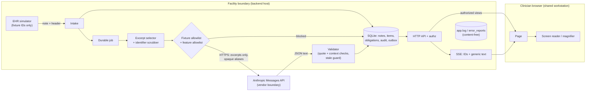

# 03. Privacy impact assessment: the complete AI data path

Scope: the prototype as built, plus what would change for a real facility. **The hackathon uses synthetic fixtures only.** The "Owner" column names a *role*. Every facility role listed must be filled by a real person before real use.

## 1. Data-flow diagram and trust boundaries



The browser never calls Anthropic. The API key exists only in the backend's environment.

## 2. What exactly leaves the facility boundary

Below is the actual request body for B's new note, captured from the app (`adapter.sent_requests`). `system` and `schema` are elided here but frozen and versioned in `app/prompt.py`.

```json
{
  "model": "claude-opus-5-5",
  "max_tokens": 16000,
  "system": "<frozen SYSTEM_PROMPT, extract-prompt-v3>",
  "messages": [{"role": "user", "content": {
      "watched_terms": ["demo signal A"],
      "excerpts": [
        {"alias": "SRC-0fb82f", "role": "current_note_excerpt", "signed": "today, this visit",
         "text": "Nursing reassessment. Patient now reports demo signal A, which started while in the waiting area. Wristband check code [code removed] confirmed."},
        {"alias": "PRI-9303c5", "role": "earlier_note_same_encounter", "signed": "earlier, this visit",
         "text": "Patient denies demo signal A. Patient's mother experienced demo signal A last year."}]}}],
  "output_config": {"format": {"type": "json_schema", "schema": "<evidence-schema-v2, no patient data>"}, "effort": "medium"}
}
```
(The `content` is sent as a JSON-encoded string; it is shown expanded here for readability.)

| Field | Why it is needed |
|---|---|
| `model` | Pins a reviewed model. A change is a reviewed config change. |
| `max_tokens` | Upper bound on output; truncation is detected and becomes a visible failure. |
| `system` | Fixed instructions: data-only treatment of note text, no diagnosis, no priority, no probabilities. |
| `watched_terms` | Tells the model which facility-configured terms to report. |
| `alias` | Request-scoped random ID (`SRC-`/`PRI-` + 6 hex). The alias→note mapping stays in the backend and is never persisted as an identifier in findings. |
| `role` | Distinguishes the current note from the comparison source (amendment vs another note). |
| `signed` | **Relative** signing context only, needed to separate signing time from observation time. No absolute dates. |
| `text` | Minimal passage: matched sentence(s) plus one neighbor sentence each side, identifier-shaped tokens scrubbed, capped at 900 chars (prior: 2 sentences, 400 chars). |
| `output_config` | Structured output (schema contains no PHI, per Anthropic's guidance) and effort level. |

**Never sent:** name, MRN, DOB, address, phone, author employee ID, absolute dates, encounter/patient/org IDs, other encounters, other patients, sentences beyond the window, and the identifier-shaped tokens listed above. Tests: `test_other_patient_canary_never_in_b_request`, `test_identifier_shaped_tokens_scrubbed_before_sending`.

**This is not de-identification.** Aliasing and a regex scrubber are *pseudonymization/minimization*. Prose like "the patient who arrived by helicopter from the county fair" can identify someone through combination. Under HIPAA, the text must be treated as PHI, and a real deployment needs a BAA-covered route regardless.

## 3. What must stay to preserve meaning

Sending only a matched keyword ("demo signal A") would remove:

| Lost context | Example | Consequence |
|---|---|---|
| Negation | "Patient **denies** demo signal A" | A false "present" finding |
| Subject | "Patient's **mother** experienced..." | Family history read as the patient's symptom |
| Time | "...resolved **last week**" | Old resolved finding read as current |
| Correction | Amendment: "On re-questioning, patient denies..." | Superseded statement treated as fact |

Test: `test_keyword_only_would_lose_meaning`. The selector keeps one neighbor sentence on each side, because negation and timing often sit there. If the matched sentences alone exceed the cap, it **abstains** (`context_exceeds_bound`) rather than truncating mid-context. The note still enters the inbox for manual review.

**Earlier note: privacy cost vs clinical cost.** Sending an earlier excerpt exposes more of the chart (bounded to 2 sentences about the same term, from one source in the same encounter). Not sending it means Claude cannot support "denied → reported." So the schema forces `change="not_comparable"`, and the validator downgrades any unsupported "new" claim. **Decision:** send the bounded earlier excerpt, because a false "new finding" or a missed reversal is the larger patient risk. The privacy officer must approve this window.

## 4. Which service actually receives the data

| Surface | Is it this app's route? | Notes |
|---|---|---|
| claude.ai consumer or Team/Enterprise chat | **No** | Not ZDR-eligible; different terms. Never paste notes there. |
| Claude Console / Workbench | **No** | Not covered by ZDR or HIPAA readiness. Prompt testing must use synthetic text only. |
| **Direct Claude API, `api.anthropic.com/v1/messages`** | **Yes (prototype)** | Anthropic is the processor. Synthetic data only at the hackathon. |
| Amazon Bedrock / Google Vertex (Google-managed) | No | The cloud provider is the processor; separate BAA and terms. A key does not carry over. |
| Microsoft Foundry, Claude Platform on AWS | No | Different eligibility (Foundry eligible with configuration; Claude Platform on AWS not HIPAA-ready). |

**Future clinical route record (every field UNVERIFIED until procurement):** organization ID ▢ · workspace ▢ · model `claude-opus-5-5` ▢ listed in BAA · endpoint `api.anthropic.com/v1/messages` ▢ · features {messages, structured outputs, effort, adaptive thinking} ▢ HIPAA-eligible in executed BAA · HIPAA readiness enabled ▢ · ZDR ▢ (cannot coexist with HIPAA readiness on one org) · processing geography ▢ (`inference_geo` not used) · subprocessors ▢ · incident contact ▢ · retention (30-day vs not-retained conflict) ▢ · BAA breach-notice timeline ▢. **A BAA or retention arrangement does not follow an API key across providers, models, organizations, or features.**

## 5. Who else might receive a copy

| Path | Risk | Control in this build | Detection | Prohibited content |
|---|---|---|---|---|
| SDK debug logging | `ANTHROPIC_LOG=debug` logs request bodies | SDK/httpx loggers forced to WARNING. Live mode **refuses to run** with debug logging. | Code check in `adapter._live` | All note text |
| Request middleware / reverse proxy | Body logging | None in the prototype. Production: no body logging at the proxy. | Proxy config review | All note text |
| Retries | Duplicate sends | SDK `max_retries=0`. Retries go through the durable job (attempt count audited). | `jobs.attempts`, audit `model_call_failed` | n/a |
| Failed-job queue | Payload stored in a queue | The job stores only IDs. The excerpt is rebuilt from the DB on each try. | Schema review | Note text in job rows |
| Exception traces | Provider errors can echo input | `report_error` stores **exception class, status code, request ID only**. Never `str(e)`. | `test_failed_request_path_does_not_leak` | Exception messages |
| Error-reporting vendor (Sentry etc.) | Full payload upload | None installed. If added: scrub, or never attach request/locals. | Canary test against the vendor sandbox | All content |
| Analytics / session replay | DOM capture of notes | None installed. **Prohibited** on clinical screens. | CSP `connect-src 'self'` blocks third-party beacons | Everything |
| Model evaluation tools | Notes copied into eval sets | Eval uses fixtures only (`scripts/evaluate.py`). | Fixture allowlist | Real notes |
| Support tickets / screenshots / demo video | Staff paste content | Policy: synthetic only. Incident ticket template uses IDs. | Training plus review | Note text, identifiers |
| Backups | Long-lived copies of notes and model responses | Prototype: local `data/` (gitignored). Production: encrypted backups, retention schedule. | Backup inventory | n/a (governed) |
| Model feedback (thumbs) | 5-year vendor retention, may train | No feedback UI. Do not submit feedback on real content. | n/a | All content |
| Repository history | Secrets and fixtures | `.gitignore` covers `data/`, `.env`, `*.key`. Key only via env var. | `grep -r sk-ant` pre-commit (recommended) | Keys, real notes |
| Browser bundle | Key exposure | The browser has no key and no Anthropic URL. CSP restricts connections to self. | `test_security_headers_and_csrf` | Keys |

## 6. Correction and deletion

| Artifact | Correct | Supersede | Delete | Governing rule |
|---|---|---|---|---|
| Source note (EHR) | Via amendment (new version) | Yes; old version kept | No (medical record retention) | Facility record retention policy and state law; HIPAA right to amend (45 CFR 164.526) |
| Approved excerpt / outbound request (`model_calls.request_json`) | No | n/a | Operational copy: purge on schedule | Facility policy. In production, do not persist the excerpt (prototype stores it only for the demo panel). |
| Model response | No | Marked `stale_discarded` when the note changes | Operational purge | Facility policy |
| Extracted evidence (findings) | Clinician correction recorded as a decision | Superseded with the note version | Retain if it informed care | Clinical record policy (**privacy officer and HIM decide** whether it is part of the designated record set) |
| Clinician decision, audit history | No (append-only) | n/a | No, within the retention period | Audit retention policy; Security Rule documentation retention (6 years for required documentation) |
| Vendor copy (Anthropic) | No | n/a | **Cannot be verified by us.** Up to 30 days standard; up to 2 years if flagged; ZDR if contracted. | Anthropic terms and BAA |
| Backups | No | n/a | Ages out per schedule | Backup policy |

We never promise deletion from systems we cannot verify.

## 7. Incident walkthroughs

**Incident 1: a note sent through the wrong vendor configuration** (e.g., a key from a non-HIPAA organization, or a Bedrock key without a BAA).
- *Discovery:* a configuration audit, or the organization ID in `model_calls`/provider request IDs doesn't match the approved org. In production, the startup check compares the configured org with the approved record.
- *Containment:* set `TRIAGE_MODE=replay` (AI off; workflow continues), revoke the key, and record the time window.
- *Affected records:* query `model_calls` by time window. Each row lists the review item and note version. **Do not copy note text into the ticket.** Reference model-call IDs and counts.
- *Preserved evidence:* model_calls rows, audit rows, deployment config history, provider request IDs.
- *Responsible:* privacy officer (breach assessment), security reviewer (containment), clinical lead (care impact).
- *Breach assessment:* the 4-factor risk assessment (45 CFR 164.402) covers the nature of the PHI, the recipient, whether it was actually acquired or viewed, and mitigation. Ask the vendor for retention and deletion status in writing.
- *Notification:* if it is a breach, notify individuals without unreasonable delay and **no later than 60 days after discovery**. HHS gets notice within 60 days if 500 or more people are affected (annual log if fewer). Media notice if more than 500 residents of one state or jurisdiction. Check **state law**, which may set shorter clocks. A business associate's notice to the covered entity is due no later than 60 days after discovery, or sooner per the BAA.
- *Continuity of care:* no effect on care order. The manual review path is unchanged.

**Incident 2: a sensitive automatic announcement on a shared workstation.**
- *By design:* automatic announcements carry **no patient label and no clinical content** (`ANNOUNCE` in `app/server.py`; `test_announcements_are_generic`; browser test checks the live region).
- *If it happened anyway* (say a code change added the patient label): the reporter tells the charge nurse, who notifies the privacy officer. Containment: roll back the release, or set the client to silent status only. Affected records: the announcement types and time window from the outbox; who was present comes from staff interviews (not logged). Assessment: an incidental disclosure may be permissible if reasonable safeguards were in place (45 CFR 164.502(a)(1)(iii)). A known defect weakens that position, so the privacy officer decides. Continuity: no effect on care data.

## 8. HIPAA duty matrix

| Duty | Rule | Implemented in software (prototype) | Facility-owned | Vendor-owned |
|---|---|---|---|---|
| Business associate agreement | Privacy/Security §164.502(e), 164.504(e) | n/a | Execute BAA; confirm eligible services, models, features | Comply with BAA; safeguard PHI |
| Minimum necessary | §164.502(b), 164.514(d) | Excerpt window, scrubber, header exclusion, fixture gate | Approve the window; role-based access policy | Use only for services |
| (Exception) treatment disclosures | Minimum necessary doesn't apply to disclosures to a provider for treatment | Not relied on: the vendor isn't a treating provider | Counsel confirms | n/a |
| Access control, unique user ID | Security §164.312(a) | Session per user; object-level authz; revocation | Identity provider, MFA, provisioning | Org/workspace access controls |
| Audit controls | §164.312(b) | Append-only audit (IDs/codes only) | **Regular audit review** (who reviews, how often) | Vendor logs per BAA |
| Integrity | §164.312(c) | Immutable deadlines (trigger); quote verification; version checks | Change control | n/a |
| Transmission security | §164.312(e) | HTTPS to Anthropic (SDK). **Prototype serves HTTP on localhost**; production needs TLS. | TLS termination, network controls | TLS on API |
| Risk analysis and management | §164.308(a)(1) | This document; risk register | Formal risk analysis, sign-off | Its own program |
| Workforce training, sanctions | §164.308(a)(5), (a)(1)(ii)(C) | n/a | Train staff: never paste notes into chat or Console | Its workforce |
| Contingency plan | §164.308(a)(7) | Replay mode; AI-off workflow; feed-stall detection | Downtime procedures (SAFER Contingency Planning) | Availability |
| Physical safeguards, workstations | §164.310 | Generic announcements; session clearing on revocation | Workstation placement, auto-lock, headphones policy | Data center |
| Incident response | §164.308(a)(6) | Content-free error reports; runbook above | Incident team; breach assessment | Notify per BAA |
| Breach notification | §§164.400–414 | Evidence preservation (model_calls, audit) | Notify individuals, HHS, media | Notify covered entity ≤60 days or per BAA |
| Patient rights: access, amendment, accounting | §164.524, .526, .528 | Decision history kept; amendments versioned | Decide record-set status of AI evidence | Assist per BAA |
| Retention | §164.316(b)(2) (documentation: 6 years) | Append-only audit | Retention schedule | Vendor retention terms |

**Open questions for state law and sensitive records:** state breach-notification timelines and content (often shorter than federal); state health-privacy laws for sensitive categories (mental health, substance use under 42 CFR Part 2, HIV/STI, reproductive health, minors); state AI-disclosure laws for patient communications. Whether patients must be told AI was involved (also a Usage Policy requirement) needs a facility decision and counsel review.
